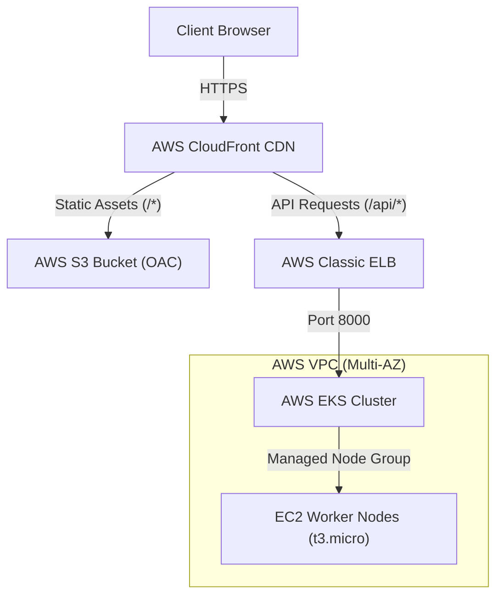

# AWS Infrastructure as Code (`infra-terraform`)

This repository contains the Terraform configuration provisioning the core AWS cloud infrastructure for the **Smart Course Scheduler (SCS)** production environment in `us-east-1`.

---

## Architecture Overview



---

## Terraform Modules

- **`modules/vpc`**:
  - Multi-AZ VPC (`10.0.0.0/16`) spanning 2 Availability Zones (`us-east-1a`, `us-east-1b`).
  - Public subnets with Internet Gateway.
  - Private subnets with NAT Gateway for secure outbound Internet access.
- **`modules/eks`**:
  - AWS EKS control plane (Kubernetes v1.30).
  - IAM Roles and OIDC provider for IRSA (IAM Roles for Service Accounts).
- **`modules/node_group`**:
  - Managed Node Group utilizing `t3.micro` EC2 instances.
  - Configured with `aws-node` IPAMD warm targets to support pod density limits.
- **`modules/s3`**:
  - Private S3 bucket hosting frontend static assets.
  - Bucket policy allowing access exclusively from CloudFront Origin Access Control (OAC).
- **`modules/cloudfront`**:
  - Global CloudFront distribution (`d3vd2js7hc9dyq.cloudfront.net`).
  - Default cache behavior: S3 bucket via Origin Access Control with SPA routing (403/404 $\rightarrow$ `index.html`).
  - Ordered cache behavior (`/api/*`): Points to the EKS Classic Load Balancer with custom origin read timeout set to **60 seconds** to support LLM synthesis.
- **`modules/dynamodb`**:
  - State locking and application persistence tables.

---

## Usage

### Prerequisites
- AWS CLI configured with admin credentials in `us-east-1`.
- Terraform 1.5+

### Commands
```bash
# Initialize Terraform and download providers
terraform init

# Review planned changes
terraform plan

# Apply infrastructure changes
terraform apply

# Target a specific module (e.g. CloudFront)
terraform apply -target="module.cloudfront" -auto-approve
```
